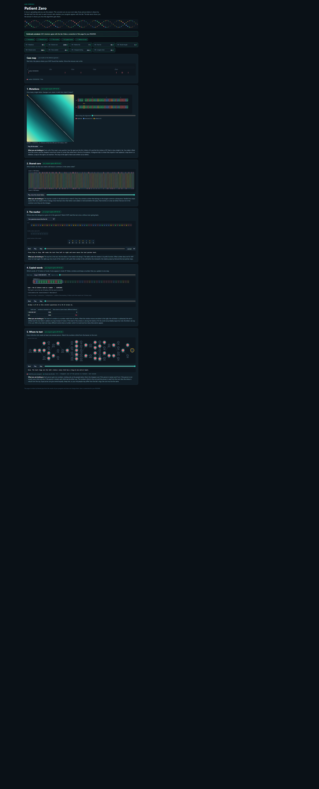

# Assignment 4. Patient Zero

Student ID: 251764
Name: Askar
Group: SE-2532

This file is the report. How to start: `START_HERE.md`. The task: `docs/Assignment4.pdf`.

## Program output

The 9 lines my program prints on my data (`java -cp out Main`):

    Mutations: 95
    Shared core: 1234
    Marker hits: 7
    First hit: 54
    Border length: 3
    Shared words: 548
    Tests needed: 25
    Cheapest testing: 112
    Longest chain: 22

My outbreak report (a screenshot of `output/outbreak.html`):

## Questions

**Mission 1. What does the cell d[i][j] of your table mean, and how is it computed from other cells?**

d[i][j] is the smallest number of changes (replace, insert, delete) needed to turn the first i letters of strain A into the first j letters of strain B. It is computed from three smaller cells: the diagonal d[i-1][j-1] (plus 1 if the last letters are different, plus 0 if they are the same), the top cell d[i-1][j] + 1 (delete a letter) and the left cell d[i][j-1] + 1 (insert a letter). I take the smallest of the three. The first row and first column are filled before the loops: d[i][0] = i and d[0][j] = j.

**Mission 2. How is the longest common subsequence different from the longest common substring? My Shared core is bigger than the number of letters that are the same at the same place: why?**

A substring must be one continuous piece, a subsequence can skip letters, it only has to keep the order. In my table, if the letters are equal I take the diagonal + 1, otherwise the bigger of the top and left cells. The Shared core (1234) is bigger than the number of equal letters at the same position because after an insertion or a deletion the rest of strain B is shifted, so the same letters are no longer at the same index, but the LCS can still match them in order.

**Mission 3. What does the prefix function tell you, and why does the pointer in the text never go back in KMP? What is the Border length of my marker and what does it mean?**

pi[i] is the length of the longest beginning of the marker (prefix) that is also an ending (suffix) of the first i+1 letters. When a letter does not match, pi tells how many letters are still matched, so we move only the marker pointer back (to pi[k-1]) and the pointer in the genome stays or goes forward: the letters we already read are known to match that border. My marker is CGCGGCGC and its Border length is 3: the beginning CGC is the same as the ending CGC. It also means that two occurrences of the marker can overlap by 3 letters, and after a full match KMP continues with 3 letters already matched.

**Mission 4. Why must you compare the letters after the hashes are equal? What happens to the cost of Rabin-Karp if many windows have the same hash?**

Two different words can have the same hash (a collision), because the hash is a number modulo MOD and there are fewer numbers than words. If I did not compare the letters I could count a word that is not really in strain B. Comparing costs k steps (k = 12), so if many windows have the same hash, we compare many times and the time grows from about O(n) to about O(n * k) and even more in the worst case, like a naive search.

**Mission 5. What are the two states of a person in your DP, and how do you get the answer for a person from its children? Why does a greedy "test the person with most links first" not always give the cheapest answer?**

For every person v I keep two numbers for v and everybody below it: the cheapest cost if v is tested, and the cheapest cost if v is not tested. If v is tested: cost[v] + for every child the smaller of its two numbers. If v is not tested: the sum of the "tested" numbers of all children, because every link v-child needs somebody tested, so every child must be tested. The answer is the smaller number at the root (person 0). Greedy can fail because it ignores costs: for example, a person with 3 links costs 100 and his 3 neighbours (leaves) cost 1 each. Greedy tests the person with the most links (cost 100), but testing the 3 leaves costs only 3.

## AI use

AI was used to brainstorm possible solutions, 
help choose the most appropriate logic for 
solving the task, and identify errors 
in the implementation of the logic in the code.

## Timing (Mission 7)

Milliseconds, average of 3 runs, from `java -cp out Bench`.

| test | size | time |
|---|---|---|
| naive search | 20 000 / 40 000 / 80 000 | 47.1 / 128.9 / 217.7 ms |
| KMP | 20 000 / 40 000 / 80 000 | 3.9 / 3.3 / 0.4 ms |
| edit distance | 500 / 1000 / 2000 / 4000 | 11.6 / 13.1 / 23.6 / 149.6 ms |

The naive search grows roughly twice when the text size doubles, so it is linear in the text length but with a big constant (the pattern is 2000 letters long, so every position costs a lot). KMP stays tiny (a few milliseconds or less) because it touches each letter of the text only once; its numbers are so small that they are mostly noise. The edit distance grows about 4 times when both strains are twice longer (the table has n * m cells); the small sizes are too fast to see it clearly, but from 2000 to 4000 the time grows a lot.

## Complexity

n is the length of the text (or of a strain), m the length of the pattern, k the length of the window, v the number of people.

| algorithm | time | space | assumptions |
|---|---|---|---|
| Edit distance | O(n * m) | O(n * m) | n and m are the lengths of the two strains; one table cell is computed in O(1) |
| LCS | O(n * m) | O(n * m) | same table as edit distance, n and m are the lengths of the two strains |
| Prefix function and KMP | O(m + n) | O(m) | prefix function O(m), search O(n), the text pointer never goes back; plus the list of found positions |
| Rabin-Karp (shared words) | O(n + m + k) on average, O(n * m * k) in the worst case | O(m) | hashes of all windows of B are in a HashMap; the worst case is when many hashes collide, then every comparison costs k |
| Tree DP | O(v) | O(v) | every person is visited once; the recursion is up to v deep |

## Before you submit

- The four files in `data` and the screenshot `output/outbreak.png` are in the repository.
- `java tools/Check.java` shows all examples right.
- This README is filled in, the program output and the section AI use included.
- The work is pushed to main (at least one commit per mission) and the repository is public.
- The link is attached in Moodle.